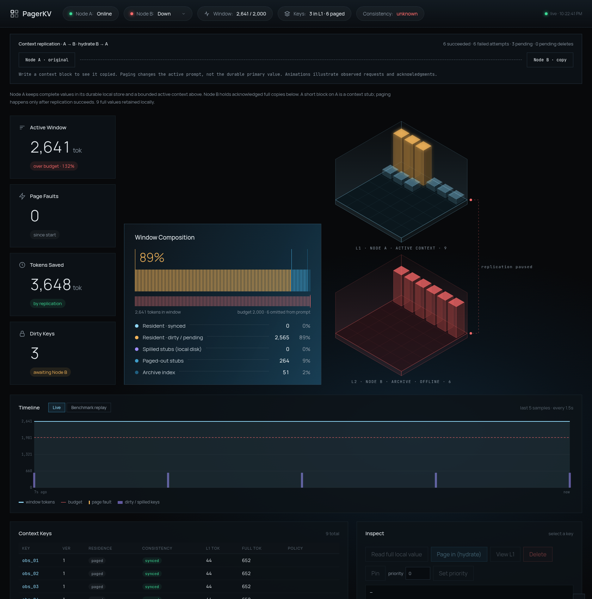
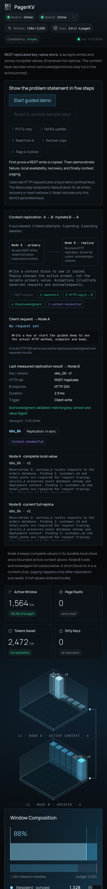
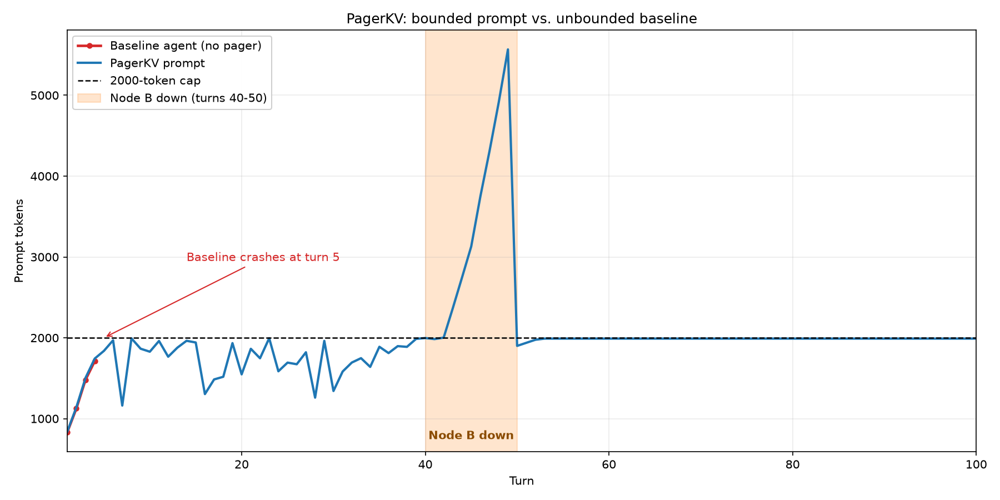

# PagerKV

**A REST-based mini distributed key-value store with visual replication and agent context paging.**

PagerKV runs two independent HTTP services. **Node A** accepts key-value writes
and sends the complete value to **Node B** for replication. It also builds a
small active context that an agent could use as its prompt. When that context
fills up, eligible full-text blocks become short stubs; the original values
remain stored separately.

> **Replication copies the original text. Paging reduces the active prompt.
> Hydration retrieves the original text. These are three separate operations.**

**Concepts demonstrated:** REST, HTTP verbs, replication, consistency, versioned
acknowledgments, failure recovery, OS dirty-bit-style safety, and context management.

## Contents

- [Problem statement alignment](#problem-statement-alignment)
- [How PagerKV goes beyond the assignment](#how-pagerkv-goes-beyond-the-assignment)
- [Design decisions & distributed systems principles](#design-decisions--distributed-systems-principles)
- [Replication, paging, and hydration](#replication-paging-and-hydration)
- [Architecture](#architecture)
- [Quick start](#quick-start)
- [Interactive CLI demonstration](#interactive-cli-demonstration)
- [Guided demonstration & web dashboard](#guided-demonstration--web-dashboard)
- [REST API](#rest-api)
- [Consistency and failure handling](#consistency-and-failure-handling)
- [Configuration and persistence](#configuration-and-persistence)
- [Tests and benchmark](#tests-and-benchmark)
- [Project structure](#project-structure)
- [Limitations](#limitations)

## Problem statement alignment

The core distributed key-value store assignment requires two HTTP services, replication on write, failure tracking, and consistency status. PagerKV fulfills every baseline requirement while applying it to a practical real-world problem: **LLM agent memory management**.

| Problem requirement | PagerKV implementation |
| --- | --- |
| Node A stores key-value pairs over HTTP | FastAPI primary service with PUT, GET, and DELETE endpoints (`/key` and `/key/{key}`) |
| A second Node B service or module | Independent FastAPI service with its own persistent SQLite archive |
| Every PUT triggers replication to B | HTTP `POST /replicate` with SHA-256 validation and versioned acknowledgments |
| Track replication success and failure | Measured round-trip times, HTTP status codes, attempt counters, error categorization |
| Show basic consistency status | Real-time comparison API (`/replication/status`), paired key inspector, and visual status badges |

## How PagerKV goes beyond the assignment

PagerKV adds the following teaching and demonstration features to the core assignment:

| Baseline assignment | PagerKV advanced implementation | Distributed systems concept |
| --- | --- | --- |
| Simple key-value store | Bounded active prompt window with priority & LRU compaction | OS memory paging & virtual memory |
| Basic mock Node B | Real independent HTTP service with SQLite + WAL + FTS5 full-text search | Tiered storage architecture (L1 cache vs L2 archive) |
| Replication call to B | Versioned acknowledgments + SHA-256 payload integrity validation | Acknowledgment validation and payload integrity |
| Binary success/failure log | Per-key state machine (`PENDING` → `SYNCED_ARCHIVED` vs `DIRTY_UNREPLICATED`) | Dirty-bit tracking & eviction safety |
| Passive status display | Live store-diff comparator (`/replication/status`) + automated background retry loop | Eventual consistency convergence & self-healing |
| Manual API verification | Redesigned modern web console + automated CLI demo script (`python demo.py`) | Developer experience & test automation |

## Design decisions & distributed systems principles

### 1. Local save, bounded initial replication, and background retry

Node A persists the complete local value, then **waits for the initial replication
attempt** before returning its response. A replica timeout or failure leaves that
value accepted locally and marks it for background retry. This is not fully
asynchronous write-back ingestion: the initial HTTP response can include the
replication timeout. Context compaction is a separate decision after the result.
B creates deterministic extractive stubs; no live LLM summarizer is involved.

### 2. Consistency-gated context compaction

The active-context view uses a dirty-bit-style guard: a block is safe to page to
its archive stub only after B acknowledges its exact current version.
`SYNCED_ARCHIVED` and matching versions allow paging; `DIRTY_UNREPLICATED` and
`PENDING_REPLICATION` do not establish a safe archive copy.

With the default settings, dirty text stays full in the active prompt even if it
exceeds the budget. Optional local spilling changes that view while retaining the
text on A. The complete primary backing value is retained independently of paging.
The **summary portion** of a stub has a 25-token budget; the full stub also includes
its version, retrieval reference, and original token count, so it is longer.

### 3. Availability during replica failure

The failure demo verifies that A can accept local writes and serve full local
reads while B rejects data requests. Global consistency becomes unknown, and
acknowledged copies can converge through retries after B recovers. The HTTP 503
simulation illustrates availability versus replica consistency; it does not prove
a formal CAP classification or arbitrary network-partition tolerance. The system
has no automatic primary failover or consensus protocol.

### 4. Deletion watermarks and content integrity

B records versioned deletion watermarks. A delayed replication at or below a
key's deletion watermark is rejected, preventing old text from restoring a
settled deletion. Newer versions may be accepted.

The SHA-256 check validates that the returned acknowledgment describes the
expected payload. It is a content-integrity check, not a digital signature or
client/server authentication mechanism.

## Replication, paging, and hydration

| Operation | What happens | What remains complete? |
| --- | --- | --- |
| **Replication — A → B** | A sends the full original value to B over HTTP | Both stored values |
| **Paging — inside A's active context** | An acknowledged full-text block becomes a short stub in the prompt | A's local backing value and B's full copy |
| **Hydration — B → A** | A fetches the archived text and restores it to the active context | The exact original text |

### Is the context compressed?

PagerKV reduces the amount of text in the **active prompt** using deterministic
extractive summaries called **stubs**. It does not apply reversible compression
such as ZIP, and it does not send shortened text instead of the original during
replication.

A stub contains a short summary, useful identifiers, the version, the original
token count, and a retrieval reference. It cannot reconstruct every detail by
itself. Exact recovery works because the complete original is preserved.
No LLM is used to generate these summaries.

For example, after an observation is replicated and then paged:

```text
Key: db_schema

Node A's durable value:   Complete original database description
Node A's active prompt:  Short stub + reference to retrieve the full text
Node B's archive:        Complete original database description
```

Paging therefore saves **prompt tokens**, not storage space. The service's total
memory and disk usage still grow with the complete dataset.

### The write-to-context lifecycle

1. **Save on A.** Store the complete text locally and assign its next version.
2. **Replicate to B.** Send the key, version, and full text through `POST /replicate`.
3. **Validate B's response.** Check the key, version, and SHA-256 content digest.
4. **Record the outcome.** Mark the version acknowledged or retain it as pending/dirty.
5. **Page only when needed.** If the active prompt exceeds its budget, replace
   eligible acknowledged blocks with stubs. Unpinned blocks with lower priority
   are considered first, followed by least recently used blocks.
6. **Hydrate on request.** Fetch the matching archived version when full context
   is needed again. Other eligible blocks may page out to make room.

B receives the full replica even when A has enough context space to keep the
block resident. Replication does not wait for paging.

## Architecture

```text
                  Client / agent / web dashboard
                                |
                PUT /key or PUT /context/{key}
                                v
        +-----------------------------------------------+
        | Node A · primary · 127.0.0.1:8001              |
        |                                               |
        | Complete local key-value backing store        |
        | Active prompt: resident blocks + short stubs   |
        | Context budget, priority/LRU, pinning, retries |
        | Atomic JSON checkpoint for restart recovery   |
        +-----------------------------------------------+
                       |                    ^
       POST /replicate |                    | GET /archive/{key}
       full text + vN  |                    | exact-text hydration
                       v                    |
        +-----------------------------------------------+
        | Node B · replica · 127.0.0.1:8002              |
        |                                               |
        | SQLite: current full value and version        |
        | Extractive stub + SHA-256 digest               |
        | Deletion watermarks + archive search          |
        +-----------------------------------------------+
```

The nodes run on the same machine for the local demonstration but communicate
through real HTTP requests. Each has separate persistence.

The "RAM" and "disk" analogy describes their context roles. A is not an entirely
volatile store: its checkpoint retains the complete local values as well as the
active-context state.

## Quick start

### Requirements

- Python 3.12+ is recommended and used in CI.
- Bash for the launcher; commands below use a Linux/Bash shell.
- Ports **8001** and **8002** available.
- Node.js 22+ for dashboard checks and the complete guided-flow integration test.
  The application itself has no Node.js runtime dependency.

From the `pagerkv` directory:

```bash
python -m venv .venv
source .venv/bin/activate
python -m pip install -r requirements-dev.txt
bash scripts/run_nodes.sh
```

For an application-only installation, install `requirements.txt` instead.

| Surface | URL |
| --- | --- |
| Web dashboard | [http://127.0.0.1:8001/ui](http://127.0.0.1:8001/ui) |
| Node A interactive API docs | [http://127.0.0.1:8001/docs](http://127.0.0.1:8001/docs) |
| Node B interactive API docs | [http://127.0.0.1:8002/docs](http://127.0.0.1:8002/docs) |

Both services bind to localhost. Press **Ctrl+C** to stop the launcher and both
nodes. Their persisted data remains available for the next run.


<details>
<summary>Start the nodes in separate terminals</summary>

Activate the virtual environment and run from `pagerkv` in each terminal.

```bash
# Terminal 1 — Node B
python -m uvicorn node_b.app:app --host 127.0.0.1 --port 8002

# Terminal 2 — Node A
python -m uvicorn node_a.app:app --host 127.0.0.1 --port 8001
```

Stop each terminal's service with Ctrl+C. Use one process per node.

</details>

### Docker

With Docker Engine and Docker Compose installed:

```bash
PAGERKV_ADMIN_TOKEN=choose-your-own-demo-token docker compose up --build
```

Open the same dashboard URL. Enter that token when the failure controls request
it. Each container has its own named data volume; ports are published on localhost.
Stop while retaining data with `docker compose down`.

A timestamp-free recording walkthrough is available in [the video demo script](docs/VIDEO_DEMO_SCRIPT.md).

## Interactive CLI demonstration

Start both services first. The CLI uses only Python's standard library; it needs
no additional client dependencies beyond a Python interpreter. The running
services still require the project's runtime dependencies.

```bash
# Interactive: pauses between steps and again at the stub before hydration.
python demo.py

# Automated: all checks run, without waiting for Enter.
python demo.py --auto --delay 0.5

# Optional custom service URLs and recovery deadline.
python demo.py --auto --delay 0 \
  --node-a http://127.0.0.1:8001 --node-b http://127.0.0.1:8002 \
  --recovery-timeout 30
```

If admin controls are protected, set `PAGERKV_ADMIN_TOKEN` in the CLI's environment
to the same token configured on both services. It is sent only with admin
requests and is not printed. B must already be Online when the CLI starts;
an existing failure mode is left unchanged.

The script verifies each phase against real HTTP responses:

1. **Save and replicate:** create a unique sample key; compare B's full text,
   version, and SHA-256 digest with the original value.
2. **Fail B and update:** verify the requested down mode, accept a newer local
   value, check dirty state and `eviction_allowed=false`, and check unknown consistency.
3. **Read locally:** compare the exact value and version returned by A, requiring
   the `LOCAL_STORE` source while B remains down.
4. **Recover:** restore B and wait for the matching replica through background
   retry, without submitting another PUT.
5. **Page and hydrate:** observe an actual `PAGED_TO_NODE_B` stub, confirm both
   stored originals remain complete, then require `L2_PAGE_FAULT` and exact text
   and version equality on hydration. The actual token budget outcome is displayed.

Each run owns a fresh `demo/cli_<uuid>/...` namespace, checks new keys are absent
before writing, and removes only its generated keys. Cleanup attempts to restore
B if this run changed its mode and verifies removal from both stores. A failed
check or incomplete cleanup returns a nonzero exit code; interruption attempts
cleanup and returns 130. Success is printed only after every phase and cleanup
have passed. Unverified replica deletion is reported explicitly.

## Guided demonstration & web dashboard

Open the [web dashboard](http://127.0.0.1:8001/ui). Use **Keys** to save and
search values, inspect the active prompt block, and compare the copies on A and
B. Open **Replication** and click **Start guided demo** to walk through these steps:

| Step | Action | What it proves |
| --- | --- | --- |
| **1. Save and copy** | Write a small, pinned sample observation through `PUT /key` | A saves the full value and B acknowledges a matching full replica |
| **2. Simulate outage** | Take B down and update the same sample key | Local acceptance can succeed while replication fails |
| **3. Read locally** | Read the complete updated value while B is unavailable | The primary value remains locally available |
| **4. Recover replica** | Restore B and wait for background retry | The latest version converges without sending another PUT |
| **5. Page and restore** | Unpin the sample and add acknowledged context | A full copy can remain replicated while its active-context representation becomes a stub |

The final step pauses at the stub. Compare **Replication: in sync** with
**Context: paged stub**, then click **Hydrate sample B → A** to restore the exact
text from the archive.

The demo uses real HTTP requests and unique `demo_...` keys. It does not overwrite
existing values. Taking B down affects all replication until recovery or reset.
**Reset demo** restores B if the demo took it down and removes that page's
generated keys. After a reload during an outage, select **Normal** in
**Manual outage simulation**. Generated keys remain identifiable by their prefix.

### Read the dashboard evidence

- **Request panel:** actual client method, endpoint, payload, Node A response,
  and client round-trip time. Long payloads are marked as display previews.
- **Replication result:** the latest global write-replication attempt's key,
  version, B HTTP status, measured duration, trigger, and validation/failure reason.
  It may describe a background retry or a write from another client.
- **Compare copies:** expand the selected key's comparison to see value previews
  and actual versions on A and B. Use **Read full value** to show the complete value.
- **Node view:** tall blocks show full context; short dashed blocks show stubs.
  B shows acknowledged full copies, including those still resident on A.
- **Context statistics:** active tokens, budget, dirty keys, page faults, and
  prompt tokens saved. The rendered prompt and archive search are also inspectable.

An HTTP 200 from A means local acceptance. It does not by itself prove successful
replication. B can also return HTTP 200 with an invalid acknowledgment, which is
recorded as a failed copy. Timeouts show **No HTTP response** rather than an
invented status code.

The dashboard polls status every 1.5 seconds. Animations illustrate observed
copy/hydration activity, respect reduced-motion preferences, and are not packet
captures. If A cannot be checked, its last displayed snapshot is marked stale.

## Dashboard screenshots

These Chromium captures show the previous dashboard design using isolated
services and sample observations written through the REST API.

### Both nodes online

Matching full replicas are acknowledged while the active prompt uses a mixture
of resident text and stubs.


### Node B unavailable

Dirty observations remain on A. The dashboard reports pending work and unknown
consistency; B's red floor indicates unavailability, not deletion of its data.



### Recovery

Background retry acknowledges the full copies, dirty count returns to zero,
and archived context can be hydrated again.


<details>
<summary>View the narrow-screen dashboard</summary>



</details>

## REST API

### Key-value operations on Node A

| Method | Endpoint | Request / behavior |
| --- | --- | --- |
| `PUT` | `/key` | `{"key":"...","value":"..."}` — save, replicate, and update context |
| `PUT` | `/key/{key}` | `{"value":"..."}` — write a named key |
| `GET` | `/key/{key}` | Read the complete local value without changing the active prompt |
| `DELETE` | `/key/{key}` | Delete the shared value/context entry and replicate the deletion |
| `GET` | `/keys` | List keys, local values, versions, and local availability |
| `GET` | `/replication/status` | Compare stores and return counters and the last measured write-replication result |
| `GET` | `/replication/key/{key}` | Compare one key's current full copies without hydrating it |

Create and inspect a value:

```bash
curl -sS -X PUT http://127.0.0.1:8001/key \
  -H 'Content-Type: application/json' \
  -d '{"key":"db_schema","value":"Postgres schema: users, orders, payments."}'

curl -sS http://127.0.0.1:8001/key/db_schema
curl -sS http://127.0.0.1:8002/key/db_schema
curl -sS http://127.0.0.1:8001/replication/key/db_schema
```

For a new key whose first version is acknowledged, PUT returns:

```json
{
  "key": "db_schema",
  "version": 1,
  "replicated": true,
  "consistency_status": "SYNCED_ARCHIVED",
  "replication_error": null
}
```

A locally accepted write returns **200** even when B is unavailable. In that case,
`replicated` is `false`, the per-key state is `DIRTY_UNREPLICATED`, and the error
explains the failed copy. The complete value remains on A for retry.

Update or delete:

```bash
curl -sS -X PUT http://127.0.0.1:8001/key/db_schema \
  -H 'Content-Type: application/json' \
  -d '{"value":"Updated schema: users, orders, payments, invoices."}'

curl -sS -X DELETE http://127.0.0.1:8001/key/db_schema
```

DELETE returns **204** after local deletion. Pending replica deletion is persisted
and retried if B is unavailable. Subsequent local GET returns **404**.

### Context operations on Node A

| Method | Endpoint | Behavior |
| --- | --- | --- |
| `PUT` | `/context/{key}` | Accept `{"text":"..."}` and replicate the same underlying value |
| `GET` | `/context/{key}` | Return the current active view: full text or stub |
| `GET` | `/context/{key}?peek=true` | Inspect the view without changing LRU access order |
| `GET` | `/context/{key}?hydrate=true` | Restore exact context from B, or use text already resident/spilled locally |
| `PATCH` | `/context/{key}` | Set `pinned` or `priority` |
| `DELETE` | `/context/{key}` | Delete the shared value and context entry |
| `GET` | `/context/status?include_text=false` | Inspect context and replication metadata without returning full text |
| `GET` | `/context/prompt` | Return the rendered prompt and token count |
| `GET` | `/context/search?q=...&limit=5` | Search local keys and B's archive |

```bash
curl -sS -X PUT http://127.0.0.1:8001/context/observation_1 \
  -H 'Content-Type: application/json' \
  -d '{"text":"The billing API reads the orders table."}'

curl -sS http://127.0.0.1:8001/context/prompt
curl -sS 'http://127.0.0.1:8001/context/observation_1?hydrate=true'
curl -sS 'http://127.0.0.1:8001/context/search?q=billing&limit=5'
```

**Choose the read you need:**

| Read | Complete value? | Changes the active context? | Requires B? |
| --- | --- | --- | --- |
| `GET /key/{key}` | Yes, from A's local backing store | No | Not for locally retained values |
| `GET /context/{key}` | Only if resident; otherwise a stub | Updates access order unless `peek=true` | No |
| `GET /context/{key}?hydrate=true` | Yes | Restores full context; other blocks may page out | Yes for an archived/paged block |

Hydration reports `source: L1`, `L1_SPILL`, or `L2_PAGE_FAULT`. It returns **503**
with an error and stub if the required B copy is unavailable, **409** on a version
mismatch, and **404** for a missing key. A locally retained value can still be read
through `/key/{key}` when B-backed hydration fails.

`/kv/{key}` remains a compatibility API; its GET uses the context hydration path.
Keys contain 1–512 characters without control characters, and values/text are
strings of at most 1,000,000 characters. Empty values and slash-containing keys
are supported by the API. The exact names `status`, `prompt`, and `search` are
reserved on the context-writing route.

### Node B endpoints

| Method | Endpoint | Purpose |
| --- | --- | --- |
| `POST` | `/replicate` | Receive a key, version, and complete `full_text` from A |
| `GET` | `/archive/{key}` | Return archived full text, version, stub, and digest |
| `GET` | `/key/{key}` | Read the full replica as a key-value response |
| `GET` | `/keys` | List current full replicas |
| `GET` | `/search?q=...&limit=5` | Search the archive |
| `GET` | `/health` | Check process availability |
| `GET` | `/ready` | Check whether the data service is ready |

Both nodes expose `/metrics`. Normal clients write through A.

## Consistency and failure handling

Replication state and context residence describe different facts:

| Per-key replication state | Meaning |
| --- | --- |
| `PENDING_REPLICATION` | The current write awaits a replication result |
| `SYNCED_ARCHIVED` | B acknowledged that exact version |
| `DIRTY_UNREPLICATED` | The copy failed or has not been acknowledged successfully |

| Context residence | Meaning |
| --- | --- |
| `RESIDENT_FULL` | Complete text is present in the active context |
| `PAGED_TO_NODE_B` | The active view uses a stub for an acknowledged archive copy |
| `SPILLED_LOCAL` | Optional outage mode uses a local stub while dirty text stays on A |

For example, **replicated + paged** means the copy succeeded but the prompt uses
a stub. **Dirty + resident** means A retains full active text while replication
needs recovery.

### Live consistency comparison

`GET /replication/status` compares current key sets, full values, and versions.
It exposes `comparison_status` as well as the compatible coarse
`consistency: consistent | degraded` field.

| Comparison | Meaning |
| --- | --- |
| `in_sync` | The datasets match and no write/deletion is pending |
| `pending` | B responded, but some work awaits acknowledgment |
| `diverged` | B responded and no work is pending, but the datasets differ |
| `unknown` | B could not be checked, or a legacy local value has not been recovered |

During an outage, **unknown consistency** and **pending updates** can both be
correct. An earlier acknowledgment does not prove B's current contents still
match. Counters count write-replication attempts, including retries; pending
deletions are tracked separately. The last attempt records its actual HTTP
status, measured duration, source, and outcome, and survives an A restart.

### Simulate failure and recovery

Use the dashboard's Online / Down / Slow control, or send:

```bash
# Fail B's data endpoints while leaving its process and admin controls available.
curl -sS -X POST http://127.0.0.1:8001/admin/node_b/fault \
  -H 'Content-Type: application/json' -d '{"mode":"down","delay_s":0}'

# A accepts this update locally; replication remains pending.
curl -sS -X PUT http://127.0.0.1:8001/key/observation_1 \
  -H 'Content-Type: application/json' -d '{"value":"Updated observation during an outage."}'

curl -sS http://127.0.0.1:8001/key/observation_1
curl -sS http://127.0.0.1:8001/replication/status

# Restore B; check again after a background retry completes.
curl -sS -X POST http://127.0.0.1:8001/admin/node_b/fault \
  -H 'Content-Type: application/json' -d '{"mode":"none","delay_s":0}'
```

Use `{"mode":"slow","delay_s":3}` to exceed the default two-second request
timeout. A timeout means the result was not acknowledged within the deadline;
B might still finish processing it. Version checks make identical retries safe.
A proxies B's `/admin/fault` controls. If a token is configured, include
`X-Admin-Token: YOUR_TOKEN` in admin requests.

### Safety and the token budget

- A pages an active block only after B acknowledges the exact current version.
- Old acknowledgments cannot mark a newer write as synced.
- B rejects stale versions and conflicting payloads claiming the same version;
  identical retries are idempotent. A can reconcile its next write above B's version.
- Versioned deletion watermarks prevent delayed writes from restoring deleted keys.
- By default, dirty blocks remain full in the active context during outages,
  even if the prompt exceeds its token budget. No text is truncated to force a fit.
- Optional `SPILL_DIRTY=1` allows dirty text to leave the prompt as a local stub;
  the full value stays on A until replication succeeds.
- Pinned blocks or blocks that cannot shrink safely may also keep the prompt
  over budget. The service reports `over_budget` explicitly.

The budget includes headers, full blocks, stubs, and the archive index. Tokens
use `tiktoken`'s `cl100k_base` encoding when available, with an approximate fallback.
Many cold stubs can be represented through `archive_index`; keys remain
discoverable through status, search, and direct reads.

## Configuration and persistence

Set environment variables before launching the services.

| Variable | Default | Purpose |
| --- | --- | --- |
| `NODE_B_URL` | `http://127.0.0.1:8002` | B's address as seen by A |
| `MAX_WINDOW_TOKENS` | `2000` | Active-prompt budget |
| `INDEX_BUDGET_TOKENS` | `150` | Tokens reserved for the archive index |
| `REPLICATION_TIMEOUT_S` | `2.0` | Timeout per A → B HTTP request |
| `RETRY_INTERVAL_S` | `3.0` | Delay between background retry passes |
| `NODE_A_STATE_FILE` | `node_a_state.json` | A's checkpoint, including full local values |
| `NODE_B_DB` | `node_b_archive.db` | B's SQLite archive |
| `SPILL_DIRTY` | `0` | Retain full dirty active text; `1` enables local spilling |
| `PAGERKV_ADMIN_TOKEN` | unset | Token for failure controls; otherwise loopback clients only |
| `PYTHON` | `python` | Interpreter used by the launcher |

A writes an atomic JSON checkpoint with flush/fsync. B uses SQLite with WAL.
Values, versions, context state, pending work, and counters survive normal service
restarts. Corrupt checkpoints fail to load rather than being replaced with empty
state. Older context checkpoints can recover missing local full values from
matching versions on B; missing values remain explicit until recovered.

The supplied Compose file forwards `MAX_WINDOW_TOKENS`, `SPILL_DIRTY`, and the
admin token, and defines its own internal node address and data paths. Additional
host environment settings require corresponding Compose configuration.

## Tests and benchmark

Install development dependencies and run:

```bash
python -m pytest -q
ruff check .
mypy
node --test tests/dashboard.test.cjs
```

Backend tests use isolated service pairs and temporary state. They cover CRUD,
replication, budgeting, safe paging, hydration, outages, retries, version conflicts,
deletions, persistence, and measured HTTP evidence. With Node.js available, the
actual guided-demo JavaScript is also exercised against real services; that test
is skipped locally if Node is absent.

Dashboard checks use a simulated DOM for rendering and interaction logic.
Website screenshots are Chromium captures; these are distinct forms of validation.
CI is configured to run lint, typing, tests, the context benchmark, and a Docker
image build.

### Context benchmark

```bash
SPILL_DIRTY=0 python bench/run_benchmark.py --check
python bench/plot.py
```

The benchmark runs 100 deterministic sample observations, compares a baseline
that keeps all context with PagerKV's active prompt, simulates B being down during
turns 40–49, and checks exact-text recovery plus retrieval-based recall. It uses
a simulated agent workflow, not a live LLM.

With spilling disabled, an outage spike is expected because dirty blocks stay
full. `--check` verifies exact recovery, the healthy-window budget, and recall
outside the outage. With `SPILL_DIRTY=1`, it also checks the all-turn prompt cap.
Results depend partly on retry scheduling and tokenization; inspect the current
[raw benchmark data](bench/results.csv) for the included run.



## Project structure

```text
pagerkv/
├── common/
│   ├── schemas.py         # REST request/response models
│   ├── tokens.py          # Shared token counting
│   ├── summarizer.py      # Deterministic extractive stubs
│   ├── validation.py      # Input limits
│   ├── admin.py           # Failure-control access checks
│   └── metrics.py         # Metrics formatting
├── node_a/
│   ├── app.py             # Primary REST/context APIs and dashboard hosting
│   ├── state.py           # Full local values, context view, paging, hydration
│   ├── replicator.py      # HTTP calls, acknowledgment checks, retry loop
│   └── config.py          # Environment settings
├── node_b/
│   ├── app.py             # Replica endpoints and failure simulation
│   └── archive.py         # SQLite storage, versions, deletion watermarks, search
├── ui/index.html          # Node visualization, evidence panels, guided demo
├── scripts/run_nodes.sh   # Start and stop both local nodes
├── docs/images/           # Website screenshots
├── bench/                 # Benchmark script, CSV, and chart
├── tests/                 # Backend, dashboard, and guided-flow checks
├── .github/workflows/ci.yml
├── Dockerfile
└── docker-compose.yml
```

## Limitations

- **Current replicas, not version history:** B stores the current live version
  of each key plus deletion watermarks, rather than every past version.
- **One primary and one replica:** there is no leader election, automatic failover,
  quorum, or distributed consensus. Run one worker per node.
- **Prompt reduction, not bounded total storage:** complete values remain stored,
  and dirty or pinned active context can exceed the configured token budget.
- **Context infrastructure, not a live agent:** no LLM API or semantic summarizer
  is integrated. Stubs are lossy summaries; retrieval preserves exact text.
- **Trusted local operation:** data endpoints have no authentication or TLS.
  The admin token protects failure controls, not the complete API.
- **Divergence is reported:** pending writes retry, but a lost archive or unexpected
  direct writes to B are not automatically rebuilt/reconciled in full.
- **Small datasets:** complete checkpoints and full-value comparisons grow with
  the dataset. Normal restart persistence is not a guarantee against losing
  both nodes' storage.
