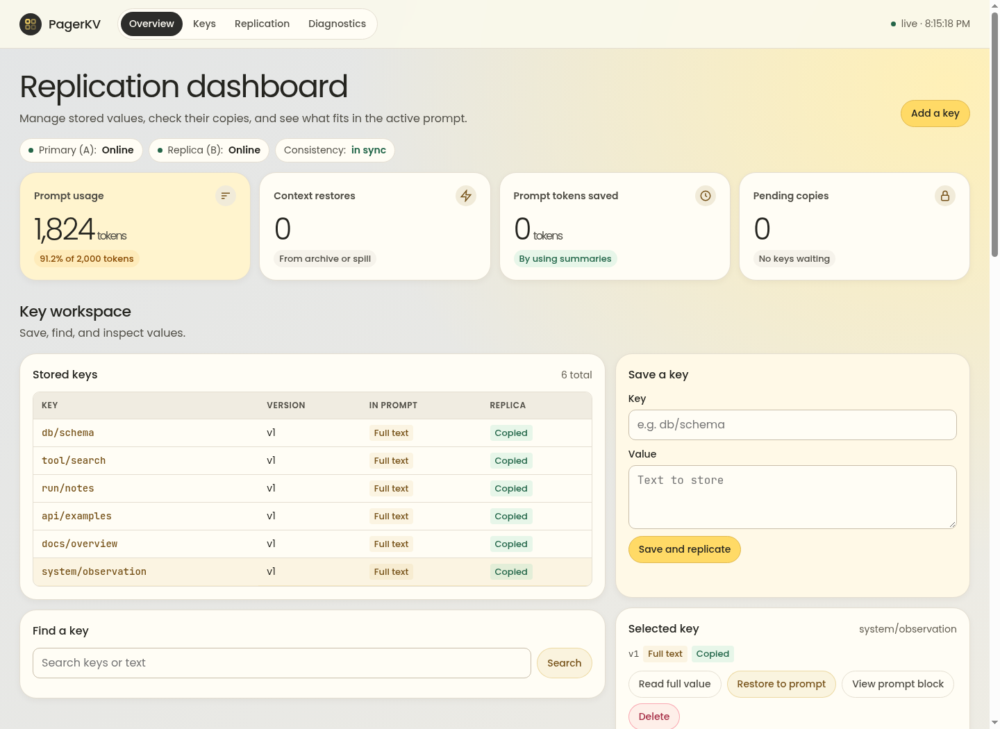
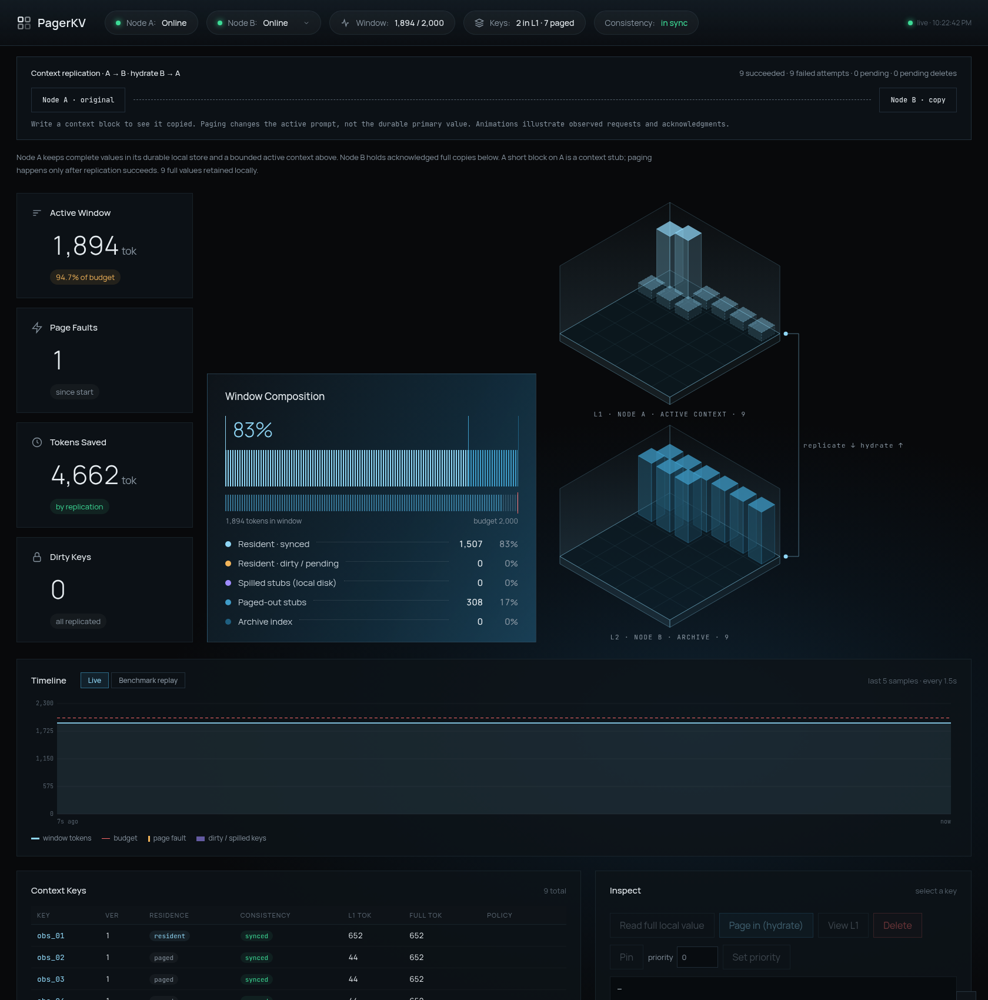

# PagerKV

### Visual REST replication for a bounded agent context

PagerKV lets an agent work with a small active context while retaining complete
observations. **Node A** accepts key-value writes, keeps durable full values,
and builds the active prompt. Every write attempts HTTP replication to **Node B**,
which stores the full text and returns a short context stub. A block can leave
the active prompt as full text only after its exact version is acknowledged.

The dashboard shows this process as two isometric nodes: full blocks and stubs
on A, acknowledged full copies on B, copying from A → B, and hydration from B → A.

**Concepts:** REST · HTTP verbs · replication · versioned acknowledgments · consistency · context management



*Real dashboard capture using sample context observations. The active prompt is
below its 2,000-token budget while both nodes retain the complete values.*

## Contents

- [Problem statement alignment](#problem-statement-alignment)
- [Architecture](#architecture)
- [Replication and context paging](#replication-and-context-paging)
- [Run locally](#run-locally)
- [Use the dashboard](#use-the-dashboard)
- [REST API](#rest-api)
- [Failure and recovery](#failure-and-recovery)
- [Consistency and safety](#consistency-and-safety)
- [Configuration](#configuration)
- [Tests and benchmark](#tests-and-benchmark)
- [Project layout](#project-layout)
- [Scope and limitations](#scope-and-limitations)

## Problem statement alignment

The required mini distributed key-value store is the foundation. Context
management is an application of that store: observation names become keys, and
observation text becomes the value.

| Requirement | Implementation |
| --- | --- |
| HTTP Node A stores key-value pairs | `PUT /key`, `GET /key/{key}`, and `DELETE /key/{key}` |
| A second Node B service or local module | Independent FastAPI service with a SQLite archive |
| Every PUT triggers replication to B | Both the key-value API and context API call the same HTTP replicator |
| Track success and failure | Persistent attempt counters, per-key errors, and acknowledged versions |
| Show basic consistency | Live full-value/version comparison, per-key states, and dashboard indicators |
| Context integration | Token-aware active prompt, stubs, paging, search, and exact-text hydration |

## Architecture

```text
                         Client / agent / dashboard
                                   |
                     PUT /key or PUT /context/{key}
                                   v
              +----------------------------------------+
              | Node A · primary · localhost:8001       |
              |                                        |
              | Complete local key-value backing store |
              |          +                             |
              | Active context: full blocks + stubs    |
              | Token budget, priority/LRU, pinning    |
              | JSON checkpoint for restart recovery  |
              +----------------------------------------+
                          |                  ^
          POST /replicate |                  | GET /archive/{key}
          full text + vN  |                  | exact-text hydration
                          v                  |
              +----------------------------------------+
              | Node B · replica · localhost:8002       |
              |                                        |
              | SQLite: current full value and version |
              | Deterministic stub + SHA-256 digest     |
              | Deletion watermarks + archive search  |
              +----------------------------------------+
```

A's **active context** and **complete local values** are separate views. Paging
shortens what goes into the prompt; it does not remove the primary value.
`GET /key/{key}` reads that complete local value without changing the prompt.
`GET /context/{key}?hydrate=true` explicitly brings archived context back through
B and updates the active view.

"RAM" and "disk" describe the context roles. Both nodes are Python HTTP services;
A's checkpoint also persists full values. The context token budget does not bound
the total memory or disk used by the service.

## Replication and context paging

For a context block such as `db_schema`:

1. **Save:** A stores the full text locally and increments its version.
2. **Replicate:** A sends the key, full text, and version to B over HTTP.
3. **Acknowledge:** B stores the text and returns its version, digest, and stub.
4. **Validate:** A checks the acknowledgment's key, version, and content digest.
5. **Page when needed:** If the prompt exceeds its budget, acknowledged,
   unpinned blocks can become short stubs in the active view. Lower priority
   blocks go first, followed by least recently used blocks.
6. **Hydrate:** An explicit context read fetches full text from B, verifies the
   version, and makes it available in the active context again. Other eligible
   blocks may page out to make room.

Replication and paging are separate events. B receives the full copy even when
A still has room to keep the block resident.

### Context states

| Residence | Meaning |
| --- | --- |
| `RESIDENT_FULL` | The active context holds the complete text |
| `PAGED_TO_NODE_B` | The active view uses a stub; B holds the acknowledged full copy |
| `SPILLED_LOCAL` | Optional outage mode: a dirty block uses a local stub while its complete text stays on A |

Tokens are counted through `common/tokens.py`, using `tiktoken`'s `cl100k_base`
encoding when available, with an approximate fallback. The budget includes prompt
headers and stubs. When many cold stubs would fill the prompt, an `archive_index`
keeps their keys discoverable through the index, status, search, and direct reads.
A stub is an extractive summary and retrieval reference; it is not the original text.

## Run locally

Use Python 3.12+ and Bash. Node.js 22+ is optional for dashboard behavior checks.
Run these commands from `pagerkv`:

```bash
python -m venv .venv
source .venv/bin/activate
python -m pip install -r requirements-dev.txt
bash scripts/run_nodes.sh
```

For a runtime-only installation, use `requirements.txt` instead.

If using the existing environment at `DS/.venv`, run from `DS/pagerkv`:

```bash
PYTHON="../.venv/bin/python" bash scripts/run_nodes.sh
```

| Surface | URL |
| --- | --- |
| Dashboard | [http://127.0.0.1:8001/ui](http://127.0.0.1:8001/ui) |
| Node A API docs | [http://127.0.0.1:8001/docs](http://127.0.0.1:8001/docs) |
| Node B API docs | [http://127.0.0.1:8002/docs](http://127.0.0.1:8002/docs) |

The launcher starts B on port 8002 and A on port 8001. Both bind to localhost.
Press **Ctrl+C** to stop them; persisted data remains for the next run.

To start the services separately, activate the environment and run from `pagerkv`
in two terminals:

```bash
# Terminal 1
python -m uvicorn node_b.app:app --host 127.0.0.1 --port 8002

# Terminal 2
python -m uvicorn node_a.app:app --host 127.0.0.1 --port 8001
```

### Docker

```bash
PAGERKV_ADMIN_TOKEN=choose-your-own-demo-token docker compose up --build
```

Open the same dashboard URL. Enter that token if the failure controls request it.
Each container has its own data volume, and ports are published on localhost only.
Stop without removing the data using `docker compose down`.

## Use the dashboard

- **Node view:** tall blocks represent full text, short dashed blocks represent
  context stubs. B shows every acknowledged copy, including blocks still resident
  on A. Hover or select a block to inspect it.
- **Replication strip and connector:** illustrate copying A → B and hydration
  B → A. Failures show red feedback; reduced-motion preferences disable movement.
- **Context statistics:** show active tokens, the budget, page faults, dirty keys,
  and prompt tokens saved by paging. Tokens saved are prompt savings, not disk savings.
- **Context Keys / Inspect:** inspect residence and replication independently,
  read the complete local value, hydrate from B, delete, pin, or change priority.
- **Add/update context:** enter a key and observation text, then PUT it. Add several
  substantial observations to see the window fill and acknowledged blocks page out.
- **Search / Rendered Prompt:** find archived observations and see the actual text
  an agent would place in its prompt.
- **Timeline / Benchmark replay:** inspect live token changes or replay the benchmark CSV.

The dashboard polls status every 1.5 seconds. Its animations illustrate observed
requests and acknowledgments; they are not network packet captures. If A becomes
unavailable, displayed status is explicitly marked stale.

## REST API

### Primary key-value API

| Method | Node A route | Behavior |
| --- | --- | --- |
| `PUT` | `/key` | Accept `{"key":"...","value":"..."}`, save, replicate, and update context |
| `PUT` | `/key/{key}` | Accept `{"value":"..."}` for a named key |
| `GET` | `/key/{key}` | Return the complete local value without hydrating the context |
| `DELETE` | `/key/{key}` | Remove the value and context entry; replicate a versioned deletion |
| `GET` | `/keys` | List keys, versions, complete local values, and local availability |
| `GET` | `/replication/status` | Return counters, per-state counts, and a live comparison result |

Example:

```bash
curl -sS -X PUT http://127.0.0.1:8001/key \
  -H 'Content-Type: application/json' \
  -d '{"key":"db_schema","value":"Postgres schema: users, orders, payments."}'

curl -sS http://127.0.0.1:8001/key/db_schema
curl -sS http://127.0.0.1:8002/key/db_schema
curl -sS http://127.0.0.1:8001/replication/status
```

PUT returns HTTP 200 after a successful local write. `replicated: true` means B
acknowledged that version; `false` means the accepted local value awaits successful
replication. The response also includes the version, consistency state, and any
`replication_error`. A failed local checkpoint write raises an error before the
replication request is sent.

DELETE returns **204**. If B is unavailable, A persists the pending deletion and
retries it. GET returns **404** after local deletion. Recreating the key uses a
version newer than the deletion watermark.

### Context API

| Method | Route | Behavior |
| --- | --- | --- |
| `PUT` | `/context/{key}` | Accept `{"text":"..."}`; save and replicate the same underlying value |
| `GET` | `/context/{key}` | Return its current full text or stub |
| `GET` | `/context/{key}?peek=true` | Read the view without changing LRU access order |
| `GET` | `/context/{key}?hydrate=true` | Restore the exact full context from B or a local spill |
| `PATCH` | `/context/{key}` | Change `pinned` or `priority` |
| `DELETE` | `/context/{key}` | Delete the shared value and context entry |
| `GET` | `/context/status?include_text=false` | Inspect context, replication, and local-value counts without full text |
| `GET` | `/context/prompt` | Return the rendered active prompt and token count |
| `GET` | `/context/search?q=...&limit=5` | Search local keys and the archive |

```bash
curl -sS -X PUT http://127.0.0.1:8001/context/observation_1 \
  -H 'Content-Type: application/json' \
  -d '{"text":"The billing API depends on the orders table."}'

curl -sS http://127.0.0.1:8001/context/prompt
curl -sS 'http://127.0.0.1:8001/context/observation_1?hydrate=true'
curl -sS 'http://127.0.0.1:8001/context/search?q=billing&limit=5'
```

`/kv/{key}` is retained as a compatibility API. Its GET returns the complete
value through the context hydration path; `/key/{key}` is the direct local read.

Keys contain 1–512 characters without control characters, and values/text are
strings of at most 1,000,000 characters. Empty values are allowed through the API.
Slashes in key names are supported. The exact keys `status`, `prompt`, and `search`
are reserved on the context-writing route because those names serve static routes.

Hydration returns **503** with an error and stub if the required B copy is
unavailable, or **409** if its version differs. A locally retained full value can
still be read through `/key/{key}` while B is offline.

### Node B and failure controls

B exposes `POST /replicate`, `GET /archive/{key}`, `GET /key/{key}`, `GET /keys`,
`GET /search`, `GET /health`, and `GET /ready`. Normal clients write through A.
The archive's current full value can be inspected with:

```bash
curl -sS http://127.0.0.1:8002/archive/db_schema
```

A proxies B's failure controls at `GET /admin/node_b/fault` and
`POST /admin/node_b/fault`:

```bash
# Down: data requests fail with 503.
curl -sS -X POST http://127.0.0.1:8001/admin/node_b/fault \
  -H 'Content-Type: application/json' -d '{"mode":"down","delay_s":0}'

# Slow: data requests take longer than the default replication timeout.
curl -sS -X POST http://127.0.0.1:8001/admin/node_b/fault \
  -H 'Content-Type: application/json' -d '{"mode":"slow","delay_s":3}'

# Restore normal operation.
curl -sS -X POST http://127.0.0.1:8001/admin/node_b/fault \
  -H 'Content-Type: application/json' -d '{"mode":"none","delay_s":0}'
```

B also exposes these controls directly at `/admin/fault`. Its health and admin
endpoints remain available during simulation; the process stays running.
If a token is configured, add `-H 'X-Admin-Token: YOUR_TOKEN'` to admin requests.

## Failure and recovery

1. Add several context blocks until some acknowledged blocks become stubs.
2. Set B to **Down** and add more observations.
3. The new observations become dirty. With the default `SPILL_DIRTY=0`, they stay
   full in the active context, even if the prompt exceeds its token budget.
4. Read complete retained values through **Read full local value**. An explicit
   B-backed hydration of a paged block can fail while B is down.
5. Restore B to **Online**. Background retries acknowledge the dirty versions,
   allowing context compaction to return under budget when no other constraint blocks it.
6. Select a paged key and hydrate it to see its full text return to the active view.


*During the outage, context safety takes priority over the token budget. The red
B floor indicates unavailability, not deletion of its previously stored data.*



*After recovery, all nine values are acknowledged, dirty count is zero, and a
successful archive hydration is recorded as a page fault.*

Set `SPILL_DIRTY=1` before launch to enable the alternate local-spill mode. Dirty
text remains on A, but can leave the active prompt as a marked local stub. This
helps preserve the token cap during an outage. Pinned or unsqueezable context
can still prevent the budget from being met; the service reports `over_budget`.

## Consistency and safety

Per-key replication follows:

```text
PUT → PENDING_REPLICATION → exact acknowledgment → SYNCED_ARCHIVED
                         ↘ timeout / failure → DIRTY_UNREPLICATED
                                                |
                                                └─ background retry → acknowledgment
```

`GET /replication/status` exposes both the compatible coarse field
`consistency: consistent | degraded` and a more specific live `comparison_status`:

| Comparison | Meaning |
| --- | --- |
| `in_sync` | Current key sets, versions, and full values match, with no pending work |
| `pending` | B responded, but A has unacknowledged writes or deletions |
| `diverged` | B responded and no work is pending, but its live dataset differs |
| `unknown` | B could not be checked, or a legacy local value has not yet been recovered |

`differing_keys` identifies mismatches when B can be inspected. Historical
acknowledgments alone do not prove the present datasets still match. Counters
measure write-replication attempts, including retries, rather than unique user writes.
Pending deletions are reported separately.

Safety rules:

- Only the exact acknowledged version can be paged out of the active context.
- Pending or dirty text is never treated as a safely archived block.
- The durable local full value is kept independently of context compaction.
- Old acknowledgments cannot mark a newer update as synced.
- B rejects stale versions; identical same-version retries are idempotent.
- Versioned deletion watermarks prevent delayed writes from resurrecting deleted keys.
- No block is silently truncated to satisfy the budget.
- Corrupt checkpoints fail to load rather than being replaced with empty state.

## Configuration

Settings are read when each service starts.

| Variable | Default | Purpose |
| --- | --- | --- |
| `NODE_B_URL` | `http://127.0.0.1:8002` | B's address as seen by A |
| `MAX_WINDOW_TOKENS` | `2000` | Active-prompt budget |
| `INDEX_BUDGET_TOKENS` | `150` | Tokens reserved for the archive index |
| `REPLICATION_TIMEOUT_S` | `2.0` | Timeout for each A → B call |
| `RETRY_INTERVAL_S` | `3.0` | Delay between retry passes |
| `NODE_A_STATE_FILE` | `node_a_state.json` | A's atomic checkpoint, including durable full values |
| `SPILL_DIRTY` | `0` | Keep dirty active text full; `1` enables local spilling |
| `NODE_B_DB` | `node_b_archive.db` | B's SQLite archive |
| `PAGERKV_ADMIN_TOKEN` | unset | Protect admin controls; without a token, only loopback clients are allowed |
| `PYTHON` | `python` | Interpreter used by the Bash launcher |

A persists state atomically with flush/fsync; B uses SQLite with WAL. Both retain
state across normal service restarts. Legacy context checkpoints can recover
missing local full values from matching versions on B. Until recovered, a missing
legacy value is reported explicitly rather than returned as a stub.

The separate `kv_node_a.db` / `kv_node_b.db` files from the plain-store version,
if present, remain untouched and are not automatically imported.

## Tests and benchmark

```bash
python -m pytest -q
node --test tests/dashboard.test.cjs
ruff check .
mypy
```

Backend tests start isolated service pairs on ephemeral ports with temporary
state. They cover context budgeting, safe paging, exact hydration, replication
failures and recovery, stale acknowledgments, deletion watermarks, local full-value
reads during outages, restart/legacy recovery, and checkpoint failures.

Dashboard checks use a simulated DOM for node-copy rendering, HTML escaping,
copy/hydration direction, reduced motion, recovery feedback, and full local reads.
The README screenshots are actual Chromium captures of the running services.

### Reproducible context benchmark

```bash
SPILL_DIRTY=0 python bench/run_benchmark.py --check
python bench/plot.py
```

The benchmark uses 100 deterministic sample observations and a simulated agent
workflow. B is down during turns 40–49. It verifies exact-text recovery and recall
through prompt/search/hydration; it does not call a real LLM.

The latest local safety-mode run produced:

| Measure | Result |
| --- | --- |
| Turns completed | 100 |
| Full values recovered exactly | 100 / 100 |
| Maximum prompt outside the outage window | 1,999 tokens |
| Maximum prompt including the outage | 6,734 tokens |
| Recall outside the outage | 28 / 28 |
| Overall recall | 29 / 30 |
| Baseline exceeds its 2,000-token budget | Turn 3 |

The outage peak is expected with dirty spilling disabled: full dirty observations
stay in context until acknowledgment. The recall miss occurs while the needed
archive content cannot be hydrated. Scheduling can change page-fault counts and
some prompt footprints between runs; `bench/results.csv` contains the current data.


`--check` verifies lossless recovery, the healthy-window budget, and recall outside
the fault window. With `SPILL_DIRTY=1`, it also checks the all-turn prompt cap.
CI is configured to run lint, type checks, tests, the context benchmark, and a
Docker build. These configuration entries are not a claim of remote CI execution.

## Project layout

```text
pagerkv/
├── common/               # Token counting, schemas, summaries, validation, admin guard
├── node_a/
│   ├── app.py            # REST/context APIs, live comparison, dashboard hosting
│   ├── state.py          # Local full values, active view, paging, retry, hydration
│   ├── replicator.py     # HTTP archive client and acknowledgment validation
│   └── config.py         # Environment settings
├── node_b/
│   ├── app.py            # Replica endpoints and fault simulation
│   └── archive.py        # SQLite storage, version guards, watermarks, search
├── ui/index.html         # Isometric nodes, event-driven animation, context controls
├── bench/                # Deterministic benchmark, raw CSV, and chart
├── docs/images/          # Website screenshots
├── scripts/run_nodes.sh  # Two-node launcher
├── tests/                # Backend and dashboard checks
├── Dockerfile
└── docker-compose.yml
```

## Scope and limitations

- The archive stores the **current version** of each live key plus deletion
  watermarks. It is not a history of every past version.
- The 2,000-token setting limits the active prompt when safe compaction is
  possible. Dirty full blocks and pinned blocks can make it exceed the budget.
- Context stubs are deterministic extractive summaries. No live LLM or semantic
  summarizer is integrated.
- A local full-value read and B-backed context hydration are intentionally
  different operations. Keeping a local value does not automatically hydrate it.
- Both nodes assume a single process. There is no leader election, failover,
  quorum, or distributed consensus.
- Data endpoints are unauthenticated and have no TLS. This is a trusted local
  teaching/demo setup; the token protects failure controls.
- Live comparison reports divergence but does not automatically rebuild a lost
  archive or remove unexpected data written directly to B.
- Complete checkpoints and full-value comparisons suit small datasets. The
  service's total memory and disk usage grow with the data.
